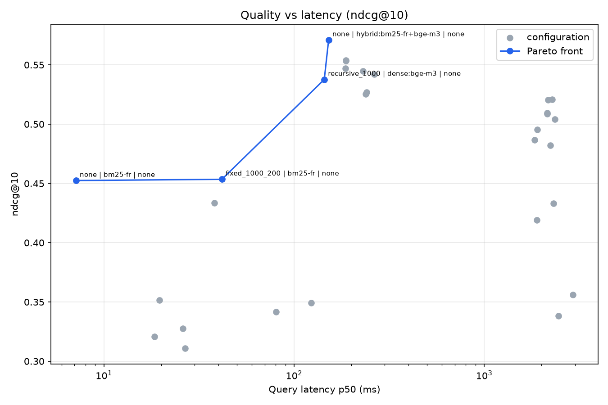

# Results v1 — Retrieval on AlloprofRetrieval

## Setup

| | |
|---|---|
| Dataset | [`lyon-nlp/alloprof`](https://huggingface.co/datasets/lyon-nlp/alloprof) (Apache-2.0), `documents` + `queries` test split |
| Corpus | 2,556 French school-help documents, indexed as `title + "\n\n" + text` |
| Queries | 300 sampled student questions (seed 42), out of 2,316 |
| Relevance | document-level, as published with the dataset |
| Grid | 3 chunkers × 6 retrievers × 2 rerankers, minus 6 excluded = 30 configurations |
| Chunk sizes | characters: `fixed_1000_200` (1,000 chars, 200 overlap), `recursive_1000` |
| Candidates reranked | 30 chunks |
| Lexical | `bm25`: lowercase word tokens only (the first baseline). `bm25-fr`: accents folded, French function words dropped, plural s/x stripped |
| Encoders | `intfloat/multilingual-e5-small`, `BAAI/bge-m3`, both capped at `max_seq_length = 512` tokens |
| Reranker | `cross-encoder/mmarco-mMiniLMv2-L12-H384-v1` |
| Hardware | AMD Ryzen 7 8845HS, 28 GB RAM, CPU only (no GPU) |
| Reproduce | `uv run rel run configs/v1.yaml && uv run rel report results/v1` |

Per-run provenance (library versions, git commit, hardware) is stored in every record of
`results/v1/results.jsonl`.

## Main results

Ranked by nDCG@10; a selection of the 30 rows (full table:
[`results/v1/report.md`](../results/v1/report.md)).

| # | Chunker | Retriever | Reranker | nDCG@10 | MRR@10 | R@5 | R@10 | p50 (ms) | p95 (ms) |
|---|---|---|---|---|---|---|---|---|---|
| 1 | none | hybrid:bm25-fr+bge-m3 | none | **0.571** | 0.531 | 0.643 | **0.762** | 152 | 280 |
| 2 | fixed_1000_200 | dense:bge-m3 | none | 0.554 | 0.522 | 0.635 | 0.709 | 188 | 367 |
| 3 | fixed_1000_200 | hybrid:bm25-fr+bge-m3 | none | 0.554 | 0.521 | 0.632 | 0.716 | 188 | 420 |
| 5 | none | dense:bge-m3 | none | 0.545 | 0.516 | 0.616 | 0.693 | 230 | 464 |
| 6 | none | hybrid:bm25+bge-m3 | none | 0.542 | 0.509 | 0.608 | 0.713 | 264 | 576 |
| 14 | fixed_1000_200 | dense:bge-m3 | minilm | 0.504 | 0.461 | 0.574 | 0.695 | 2,348 | 2,778 |
| 15 | fixed_1000_200 | bm25-fr | minilm | 0.495 | 0.463 | 0.562 | 0.654 | 1,901 | 3,104 |
| 18 | fixed_1000_200 | bm25-fr | none | 0.453 | 0.416 | 0.525 | 0.633 | 42 | 152 |
| 19 | none | bm25-fr | none | 0.452 | 0.413 | 0.511 | 0.643 | 7 | 25 |
| 21 | fixed_1000_200 | bm25 | minilm | 0.433 | 0.417 | 0.478 | 0.551 | 2,310 | 3,243 |
| 24 | none | bm25 | none | 0.351 | 0.323 | 0.410 | 0.502 | 20 | 71 |
| 28 | none | dense:e5-small | none | 0.328 | 0.303 | 0.389 | 0.455 | 26 | 48 |

Only 4 of the 30 configurations are on the quality/latency Pareto front: `none + bm25-fr` (7 ms, 0.452), `fixed_1000_200 + bm25-fr` (42 ms, 0.453), `recursive_1000 + dense:bge-m3` (144 ms, 0.538), `none + hybrid:bm25-fr+bge-m3` (152 ms, 0.571). Every reranked configuration is dominated. All non-reranked latencies were measured in one session; reranked ones in an earlier session on the same machine.

## Findings

### 1. An untuned baseline had inflated the headline

The first version of this benchmark reported that bge-m3 beat BM25 by +58% nDCG@10
(0.554 vs 0.351). That BM25 only lowercased the text and split it on word characters: no
accent folding, no stop-word removal, no handling of plurals. "Je ne comprends pas bien les
divisions" therefore never matched the fact sheet titled "La division", and "je", "ne", "pas"
weighed as much as the one word that mattered.

`bm25-fr` adds the minimum a French lexical baseline needs — accents folded, about 130
function words dropped, a trailing plural s/x stripped — in some thirty lines of code:

| Chunker | `bm25` (raw) | `bm25-fr` | Δ |
|---|---|---|---|
| none | 0.351 | 0.452 | **+29%** |
| fixed_1000_200 | 0.349 | 0.453 | +30% |
| recursive_1000 | 0.342 | 0.433 | +27% |

Against a baseline that has been given a fair chance, bge-m3 leads by **+22%** (0.554 vs 0.453
at `fixed_1000_200`), not +58%. Two thirds of the original gap was the tokenizer. The raw
`bm25` stays in the grid on purpose: the difference between the two rows is the cost of not
tuning a baseline, and it is the easiest mistake to make in a benchmark of this kind.

### 2. The embedding model decides, not the lexical/dense dichotomy

bge-m3 scores 22% above a tuned BM25; e5-small — also a dense bi-encoder — scores **27% below
it** (0.328 vs 0.452). "Switching to dense retrieval" is not a decision by itself: the same
architecture spans the best and the worst results in this grid. Model capacity matters here
(bge-m3: 568M parameters, 1024-dim; e5-small: 118M, 384-dim), and so does multilingual
training quality on French.

### 3. A reranker only helps a first stage weaker than itself

All four at `fixed_1000_200`, reranking the top 30 chunks with `mmarco-mMiniLMv2`:

| First stage | nDCG@10 without reranker | with `minilm` | Δ |
|---|---|---|---|
| bm25 (raw) | 0.349 | 0.433 | **+24%** |
| bm25-fr | 0.453 | 0.495 | +9% |
| hybrid bm25-fr+bge-m3 | 0.554 | 0.520 | −6% |
| dense bge-m3 | 0.554 | 0.504 | **−9%** |

The gain shrinks as the first stage improves and turns negative once the first stage is
better than the reranker, while every reranked configuration costs about two more seconds per
query on this CPU. A cross-encoder only helps when it is more accurate than the ranking it
rewrites — and reranking the top 30 also caps recall at what the first stage already found.

### 4. Hybrid search pays once the lexical side is competent

Fused with the raw BM25, RRF only matched the dense retriever (0.542 vs 0.545). Fused with
`bm25-fr`, the same fusion is the best configuration of the grid: **0.571 nDCG@10 and 0.762
recall@10, against 0.545 and 0.693 for bge-m3 alone**. Nothing changed but the tokenizer of
one side.

Hit@10 over the 300 queries, all at `chunker: none` so the systems are compared like for like:

| | with `bm25` (raw) | with `bm25-fr` |
|---|---|---|
| dense bge-m3 alone | 221 | 221 |
| lexical alone | 164 | 206 |
| hybrid (RRF) | 226 | **241** |
| union of dense and lexical (oracle) | 244 | 251 |
| lexical-only queries recovered by fusion | 16 of 23 | 24 of 30 |
| dense-only queries forfeited by fusion | 21 | 13 |

Equal-weight RRF trades hits in both directions: it recovers queries only the lexical side
solved, and forfeits queries only the dense side solved, because a confident-but-wrong ranking
from one side drags a correct hit out of the top 10. With a weak lexical side the trade is
almost neutral (+16 −21 around a net +5); with a competent one it is clearly positive
(+24 −13, net +20). The same pattern holds with the other chunkers (`fixed_1000_200`: 16
recovered, 15 forfeited; `recursive_1000`: 21 and 9).

Ten queries (3.3 points of hit@10) still separate RRF from the oracle union. Weighted fusion
could claim part of that; it is a smaller prize than it looked when the lexical side was
broken (18 queries, 6 points).

### 5. Chunking's effect is entangled with the 512-token cap — and this grid cannot separate them

Fixed-size chunking gives bge-m3 +1.7% (0.545 → 0.554), leaves both BM25 variants flat
(0.452 → 0.453 for `bm25-fr`) and costs the best hybrid 3% (0.571 → 0.554). That looks like
"chunking barely matters here", but the comparison is
confounded, and the corpus statistics say why.

Alloprof documents are **not** short: mean 3,541 characters, median 2,568, p90 7,550, max
47,973 — about **60% exceed ~2,000 characters**, roughly 512 tokens of French. Both encoders
run with `max_seq_length = 512` (a project setting, not a model limit: bge-m3 supports 8,192),
so at `chunker: none` the dense retriever never sees the second half of the median document.
The chunked configurations are therefore not "the same content, cut up" — they are the only
configurations that index the whole corpus.

Two consequences for reading this grid:

- The +1.7% chunking gain is measured against a **truncated** baseline. Chunking's real effect
  on this corpus is unresolved, not small.
- At `chunker: none`, BM25 indexes the full document text while the dense retriever sees a
  prefix, so "e5-small scores below BM25" is not a like-for-like comparison at that row. The
  bge-m3-vs-BM25 gap of Finding 1 is unaffected: it is taken at `fixed_1000_200`, where both
  sides index the whole corpus. The best hybrid, at `chunker: none`, combines a truncated dense
  side with a full-text lexical side — which may be part of why it wins there.

Separating the two effects needs one extra run with `max_seq_length: 8192` at
`chunker: none` — the first thing v2 should measure.

### 6. Practical recommendation

Pick by latency budget, not by reputation:

- **A few milliseconds**: `bm25-fr` on whole documents (0.452). Free to index, no model to
  host, and 29% better than the same algorithm without French analysis.
- **A few hundred milliseconds**: `hybrid:bm25-fr+bge-m3` on whole documents (0.571, and the
  best recall of the grid at 0.762).
- **Reranking**: not worth it here (−6% to −9% on the strong first stages, +2 s) unless the
  first stage is weak.

## Failure analysis

76 of 300 queries have no relevant document in the top 10 for the best configuration (79 for
the same retriever at `chunker: none`, the setting used in the table below so that dense and
BM25 stay comparable). Reading them shows four distinct causes; ranks come from the committed
per-query runs (`results/v1/runs/`).

| Query | Expected document | What the dense retriever returned | BM25 | Cause |
|---|---|---|---|---|
| "estimation d'une addition de nombres décimaux" | *Le calcul mental* | *L'addition de nombres décimaux*, *La multiplication de nombres décimaux*, *L'addition* | rank 5 | **Label sparsity**: the retrieved sheets are arguably valid answers; one labelled document penalises a reasonable ranking |
| "calculer la température avant la réaction d'un mélange de deux substances" | *La calorimétrie (Q = m c ΔT)* | *La détermination du point de fusion*, *La mesure de la température*, *La température* | **rank 1** | **Lost technical term**: the query paraphrases a formula the sheet names explicitly; the dense encoder drifts to the generic topic, exact term matching wins |
| "évaluation demain, les 4 opérations sur les entiers relatifs" (4 relevant docs) | *La division / soustraction / addition / multiplication de nombres entiers* | *Répertoire de révision – Mathématiques – Primaire*, *Révision et examen en mathématiques*, … | **rank 1** | **Meta-intent capture**: the dense encoder anchors on "révision / examen" and on the wrong school level instead of the notions being revised |
| "je dois écrire *tel* ou *telle* dans cette phrase…" | *Tel et tel que* | *La modalisation*, *Either*, *Le subjonctif* | not in top 10 | **Vocabulary mismatch**: neither system retrieves the sheet — its title is the bare grammar form, which matches neither the paraphrase nor the surrounding medical sentence |

Two of these four are cases where BM25 ranks the answer first or fifth while the best
configuration misses it entirely — the churn quantified in Finding 3, seen one query at a time.

The first cause also inflates the apparent error rate: part of the 25% "failures" are ranking
choices a human would accept. Any absolute number here should be read as a lower bound on real
quality, which is exactly why the benchmark compares configurations against each other rather
than reporting a single score.

## Limitations

- **One dataset, one domain.** French school-help sheets, short and single-topic. Conclusions
  about chunking in particular will not transfer to long technical or legal documents.
- **300 of 2,316 queries.** Sampled with a fixed seed for a CPU budget; differences below
  ~2 points of nDCG@10 should not be treated as significant.
- **Document-level relevance, single labelled answer for most queries** — see the failure
  analysis: the metric under-counts acceptable answers.
- **Dense retrieval is truncated at 512 tokens** while BM25 indexes full documents, so rows at
  `chunker: none` are not like-for-like across retriever families (see Finding 4).
- **Latency is CPU-only, single process, batch size 1**, measured on a laptop. On a GPU the
  reranker's 2 s collapses and conclusion 2 would need re-measuring — the trade-off is
  hardware-dependent, the quality ranking is not.
- **One index-time measurement is invalid**: `fixed_1000_200 + dense:bge-m3` reports
  77,157 s because the machine slept mid-encoding. The real value, extrapolated from the
  encoding rate, is ≈ 7,500 s (~2 h); comparable configurations took 1,996 s (2,556 chunks)
  and 6,904 s (11,022 chunks). Wall-clock index times are not sleep-aware.
- **Embedding cache**: index times are cold-cache only when a model/chunker pair is computed
  for the first time; cached runs report ~0 s.
- **No generation stage.** This benchmark stops at retrieval; answer faithfulness is v2.

## What v2 should test

1. `max_seq_length: 8192` for bge-m3 at `chunker: none`, to separate the effect of chunking
   from the effect of the 512-token cap (Finding 4).
2. Weighted or learned fusion instead of plain RRF — the oracle union is 6 points of hit@10
   above RRF, and the recovered/forfeited split (16 vs 21) says where the loss comes from.
3. A stronger reranker (`bge-reranker-v2-m3`) on a subset, to separate "reranking is useless"
   from "this reranker is too weak".
4. The full generation stage: faithfulness and answer relevance judged by an LLM, with the
   judge calibrated against human labels.
