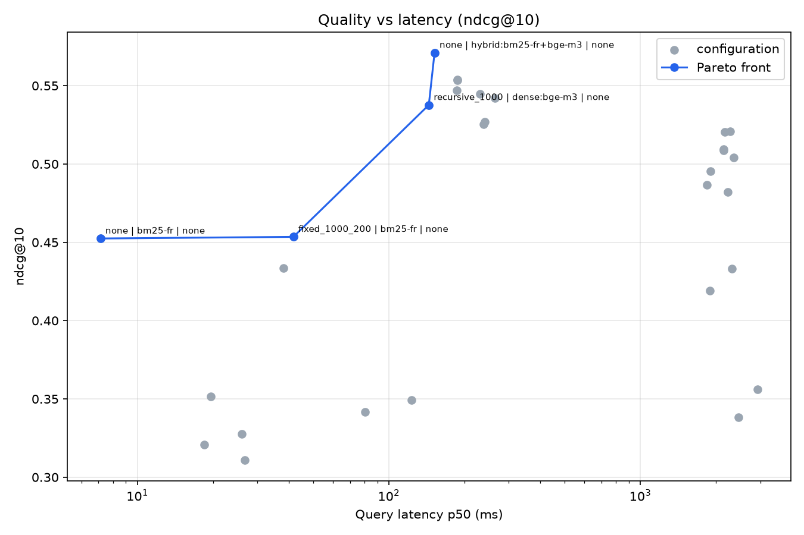
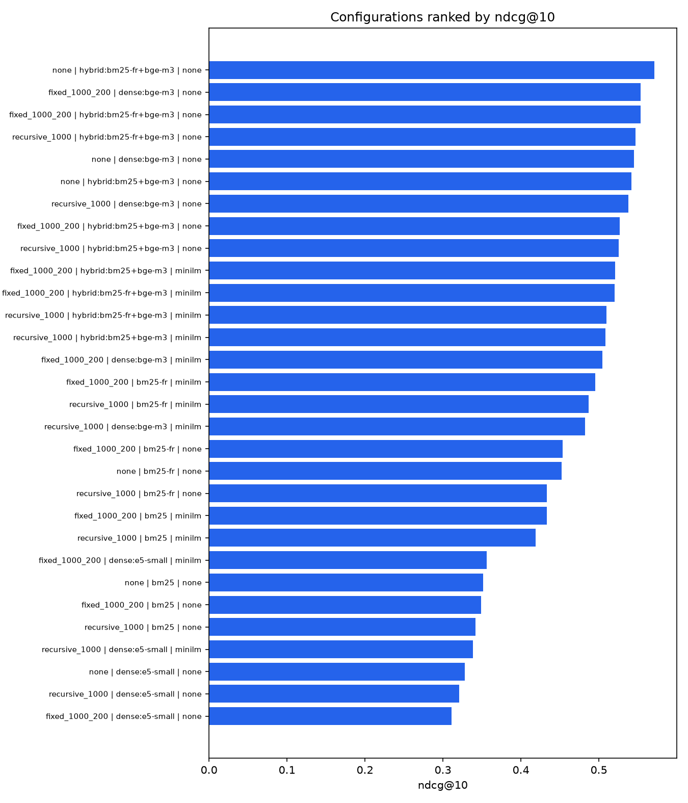

# Retrieval benchmark report

- Configurations: 30
- Queries: 300
- Primary metric: `ndcg@10`

| Rank | Chunker | Retriever | Reranker | mrr@5 | mrr@10 | ndcg@5 | ndcg@10 | recall@5 | recall@10 | p50 (ms) | p95 (ms) | Index (s) | Chunks | Pareto |
|---|---|---|---|---|---|---|---|---|---|---|---|---|---|---|
| 1 | none | hybrid:bm25-fr+bge-m3 | none | 0.516 | 0.531 | 0.531 | 0.571 | 0.643 | 0.762 | 152.0 | 280.0 | 1.4 | 2556 | ★ |
| 2 | fixed_1000_200 | dense:bge-m3 | none | 0.512 | 0.522 | 0.529 | 0.554 | 0.635 | 0.709 | 187.5 | 367.1 | 0.1 | 12022 |  |
| 3 | fixed_1000_200 | hybrid:bm25-fr+bge-m3 | none | 0.511 | 0.521 | 0.525 | 0.554 | 0.632 | 0.716 | 187.7 | 420.0 | 1.9 | 12022 |  |
| 4 | recursive_1000 | hybrid:bm25-fr+bge-m3 | none | 0.492 | 0.507 | 0.512 | 0.547 | 0.636 | 0.740 | 185.8 | 416.3 | 2.1 | 11022 |  |
| 5 | none | dense:bge-m3 | none | 0.504 | 0.516 | 0.519 | 0.545 | 0.616 | 0.693 | 230.4 | 464.0 | 0.0 | 2556 |  |
| 6 | none | hybrid:bm25+bge-m3 | none | 0.497 | 0.509 | 0.506 | 0.542 | 0.608 | 0.713 | 264.5 | 576.4 | 1.0 | 2556 |  |
| 7 | recursive_1000 | dense:bge-m3 | none | 0.497 | 0.508 | 0.513 | 0.538 | 0.618 | 0.688 | 144.2 | 279.7 | 0.2 | 11022 | ★ |
| 8 | fixed_1000_200 | hybrid:bm25+bge-m3 | none | 0.477 | 0.490 | 0.494 | 0.527 | 0.609 | 0.702 | 240.2 | 641.3 | 1.0 | 12022 |  |
| 9 | recursive_1000 | hybrid:bm25+bge-m3 | none | 0.482 | 0.495 | 0.490 | 0.525 | 0.590 | 0.694 | 237.8 | 634.0 | 1.0 | 11022 |  |
| 10 | fixed_1000_200 | hybrid:bm25+bge-m3 | minilm | 0.463 | 0.479 | 0.480 | 0.521 | 0.592 | 0.710 | 2275.7 | 3028.6 | 5.4 | 12022 |  |
| 11 | fixed_1000_200 | hybrid:bm25-fr+bge-m3 | minilm | 0.463 | 0.479 | 0.480 | 0.520 | 0.592 | 0.707 | 2162.5 | 3018.3 | 4.6 | 12022 |  |
| 12 | recursive_1000 | hybrid:bm25-fr+bge-m3 | minilm | 0.443 | 0.461 | 0.464 | 0.510 | 0.586 | 0.721 | 2144.6 | 2988.1 | 5.2 | 11022 |  |
| 13 | recursive_1000 | hybrid:bm25+bge-m3 | minilm | 0.440 | 0.460 | 0.461 | 0.509 | 0.580 | 0.720 | 2146.2 | 2886.0 | 5.3 | 11022 |  |
| 14 | fixed_1000_200 | dense:bge-m3 | minilm | 0.447 | 0.461 | 0.464 | 0.504 | 0.574 | 0.695 | 2348.1 | 2777.7 | 5.3 | 12022 |  |
| 15 | fixed_1000_200 | bm25-fr | minilm | 0.452 | 0.463 | 0.465 | 0.495 | 0.562 | 0.654 | 1900.8 | 3104.5 | 4.4 | 12022 |  |
| 16 | recursive_1000 | bm25-fr | minilm | 0.440 | 0.452 | 0.455 | 0.487 | 0.561 | 0.654 | 1842.8 | 2634.0 | 5.4 | 11022 |  |
| 17 | recursive_1000 | dense:bge-m3 | minilm | 0.425 | 0.440 | 0.446 | 0.482 | 0.566 | 0.674 | 2225.7 | 2691.8 | 4.8 | 11022 |  |
| 18 | fixed_1000_200 | bm25-fr | none | 0.400 | 0.416 | 0.416 | 0.453 | 0.525 | 0.633 | 41.7 | 152.1 | 2.3 | 12022 | ★ |
| 19 | none | bm25-fr | none | 0.396 | 0.413 | 0.407 | 0.452 | 0.511 | 0.643 | 7.1 | 24.6 | 1.4 | 2556 | ★ |
| 20 | recursive_1000 | bm25-fr | none | 0.382 | 0.396 | 0.398 | 0.433 | 0.511 | 0.614 | 38.0 | 140.8 | 2.0 | 11022 |  |
| 21 | fixed_1000_200 | bm25 | minilm | 0.406 | 0.417 | 0.408 | 0.433 | 0.478 | 0.551 | 2310.0 | 3243.4 | 8.3 | 12022 |  |
| 22 | recursive_1000 | bm25 | minilm | 0.386 | 0.399 | 0.390 | 0.419 | 0.467 | 0.549 | 1895.9 | 2720.4 | 5.9 | 11022 |  |
| 23 | fixed_1000_200 | dense:e5-small | minilm | 0.316 | 0.325 | 0.333 | 0.356 | 0.414 | 0.483 | 2930.8 | 3066.7 | 4.6 | 12022 |  |
| 24 | none | bm25 | none | 0.310 | 0.323 | 0.320 | 0.351 | 0.410 | 0.502 | 19.6 | 70.5 | 0.7 | 2556 |  |
| 25 | fixed_1000_200 | bm25 | none | 0.310 | 0.320 | 0.324 | 0.349 | 0.421 | 0.493 | 123.1 | 555.8 | 1.6 | 12022 |  |
| 26 | recursive_1000 | bm25 | none | 0.301 | 0.312 | 0.313 | 0.342 | 0.406 | 0.487 | 80.4 | 292.2 | 0.8 | 11022 |  |
| 27 | recursive_1000 | dense:e5-small | minilm | 0.305 | 0.314 | 0.316 | 0.338 | 0.390 | 0.455 | 2458.6 | 2672.8 | 4.9 | 11022 |  |
| 28 | none | dense:e5-small | none | 0.294 | 0.303 | 0.305 | 0.328 | 0.389 | 0.455 | 26.1 | 48.5 | 0.1 | 2556 |  |
| 29 | recursive_1000 | dense:e5-small | none | 0.281 | 0.292 | 0.293 | 0.321 | 0.372 | 0.456 | 18.4 | 33.8 | 0.1 | 11022 |  |
| 30 | fixed_1000_200 | dense:e5-small | none | 0.264 | 0.276 | 0.280 | 0.311 | 0.362 | 0.454 | 26.7 | 47.7 | 0.1 | 12022 |  |

## Notes

- Latency is measured per query on CPU, including query encoding and reranking.
- Index time includes embedding computation only when the embedding cache was cold.
- ★ marks configurations on the quality/latency Pareto front.
- Reranking only rescores the first-stage candidate pool (`candidates` chunks per query), so recall is bounded by that pool and cannot exceed it.
- The index-time column mixes cold and warm embedding-cache runs, and can be inflated if the machine slept mid-run; treat it as diagnostic only, not a comparable cost metric.
