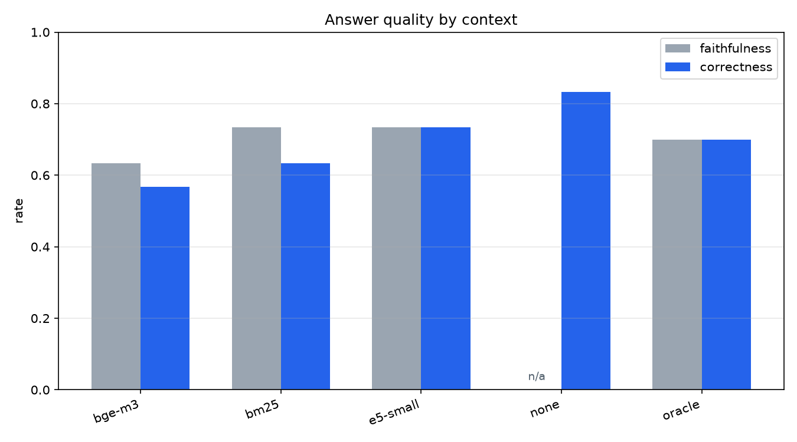

# Generation benchmark report

- Contexts: 5
- Judged answers: 150
- Human annotations: 60

| Context | n | faithfulness | relevance | correctness | latency p50 (ms) | mean passage chars |
|---|---|---|---|---|---|---|
| bge-m3 | 30 | 0.633 | 0.800 | 0.567 | 31673 | 4675 |
| bm25 | 30 | 0.733 | 0.933 | 0.633 | 160186 | 24704 |
| e5-small | 30 | 0.733 | 0.867 | 0.733 | 130031 | 16546 |
| none | 30 | n/a | n/a | 0.833 | 8080 | 0 |
| oracle | 30 | 0.700 | 0.833 | 0.700 | 28356 | 3686 |

## Calibration — judge against human labels

| Criterion | n | agreement | 95% CI | kappa | judge positive | human positive | tp/fp/fn/tn |
|---|---|---|---|---|---|---|---|
| faithfulness | 48 | 0.396 | [0.270, 0.537] | -0.308 | 0.729 | 0.583 | 17/18/11/2 |
| correctness | 51 | 0.588 | [0.452, 0.712] | 0.249 | 0.608 | 0.275 | 12/19/2/18 |

## Notes

- `faithfulness` and `relevance` are not judged for the `none` context: without passages,
  grounding is undefined. Those cells read `n/a`.
- Agreement counts only answers that carry both a human label and a judge verdict;
  `?` answers during annotation are stored as null and excluded.
- Confusion is reported judge-versus-human: `fp` means the judge said true where the
  human said false (an indulgent judge), `fn` the opposite (a severe one).
- Kappa reads `undefined` when the judge or the human gave the same label to every
  answer (positive rate of exactly 0 or 1): chance agreement is then total and kappa
  has no meaningful value. This is not the same as a kappa of 0, which would mean the
  judge is no better than chance.
- A calibration row with n = 0 reads `n/a` throughout: nothing was measured, which is
  not the same as a judge that never agrees.
